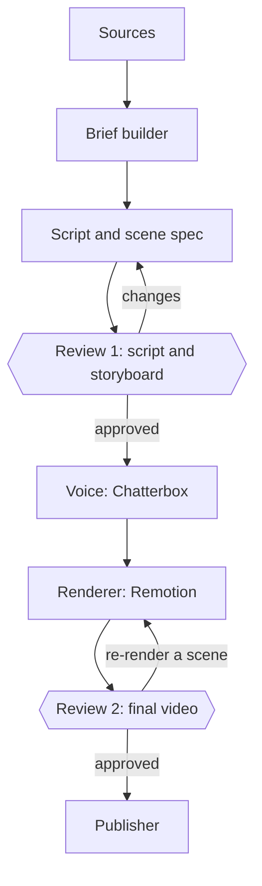

# build-agentic-systems — System Plan

My back-of-the-napkin plan for this project. Nothing here is a commitment; it changes as I learn.

Each part is marked **built**, **manual** (done by hand for now), or **planned**.

## Why this exists

This is a casual, learn-by-building project. I'm learning to build agentic AI systems, and what I'm building is a pipeline that turns a topic into an animated explainer video. The videos are about building it.

1. **Learning.** The main reason. Each concept I implement (agents, harnesses, spec-driven development, GraphRAG, agent memory) can become a video.
2. **Build in public.** The videos are about the system that makes them, so every video is also a demo.

This repo is the open-source **engine**. AmbarVista's creative work (scripts, scene specs, voice, brand, personas) lives in a separate private repo.

## Tone and pace

This is a casual project. Learning comes first, and I'm the first audience.

- **No schedule, no promises.** Videos come out when there's something worth showing. Nothing in a video, description, or README commits to a cadence, a future episode, or a feature date.
- **Talk about what's next as intent, not commitment:** "what I'm working on next" instead of "next week we'll build."
- **Make what's interesting to me,** but explain it so someone without the context can follow.
- **Small is fine.** A short technique video counts. Imperfect and shipped beats polished and stalled.
- **Build the next useful piece, not the full architecture.** Add a database, a review app, or another platform when the manual way becomes real friction.
- **Keep the safeguards, lightly.** Honesty about what's built, sources, disclaimers, and security stay, using the simplest process that works. Automate a safeguard only when that becomes useful.

## What it makes

- **Format:** short animated explainers built as code (Remotion), narrated in my cloned voice. Length is whatever the topic needs. Style reference: Caleb Writes Code's "Agent Harness explained in 8min".
- **Where:** YouTube [@AmbarVista](https://www.youtube.com/@AmbarVista). Vertical cuts for Instagram and Facebook are an idea for later, only if they seem worth it.

## Episode ideas

A list of ideas, not a schedule. Order and topics change with what I actually build.

| Idea | Core idea |
|------|-----------|
| Introducing the pipeline (Episode 0) | What I'm building and why; made by the first working slice of the system |
| Security-first: an agent that audits your repo | Manual audit of a GitHub org and repo, then an agent that audits and, with approval, applies a security baseline; which settings the API can't change |
| The constitution: rules agents must follow | Writing the constitution, and why each principle exists |
| Onboarding agents: CLAUDE.md and AGENTS.md | How agents find the constitution, the plan, and the specs |
| What is an agent? | The sense → decide → act loop, from thermostats and daemons to LLM agents |
| Agent harnesses | What surrounds the model: tools, loops, context |
| Spec-driven development | Specs, plans, and tasks with Spec Kit |
| GraphRAG | Entities and relationships instead of loose chunks |
| Agent memory and dreaming | In-the-moment notes vs. curated, promoted lessons |
| Local to AWS | Deploying the same system to the cloud |

The constitution and agent instructions come before agents write pipeline code, since agents need the rules first.

**Openings:** aim for a clear, truthful opening that makes me curious. No formula required.

## Architecture (the eventual shape)

This is where the pipeline could end up. Only parts marked **built** exist; the rest get added one at a time, when they're useful.



| Stage | Status |
|-------|--------|
| Sources | manual (notes and docs) |
| Brief builder | planned |
| Script and scene spec | manual (written with Claude's help) |
| Review 1 and Review 2 | manual (me) |
| Voice (Chatterbox) | planned, first slice |
| Renderer (Remotion) | planned, first slice |
| Publisher | manual (upload to YouTube by hand) |

- **Python** runs the pipeline. **TypeScript (Remotion)** only renders.
- The **scene spec (versioned JSON)** is the contract between them. The language boundary is a file and an exit code.

### Interfaces

Interfaces go at boundaries with outside technology (renderer, voice, LLM, publisher), so a tool can be swapped without touching the rest. Add each one when the stage is built, not before. If there's no realistic second implementation, there's no interface yet.

### Repo layout (grows as needed)

```text
build-agentic-systems/
  apps/
    pipeline/        Python (uv): CLI and stages, as they're built
    renderer/        TypeScript: Remotion project and components
  libs/
    scene-spec/      Versioned JSON Schema shared by Python and TypeScript
  scripts/security/  Security baseline scripts (built)
  docs/plan.md       This file
  specs/             Spec Kit feature specs
```

Plain folders with uv and npm to start. Nx can be added later with `nx init` on the existing repo, when there are enough projects to coordinate; that would make a good episode on its own. A database, a job queue, and a review web app are also options for later, if managing things by hand gets painful.

## Scene spec

The first piece of the data model, needed for the first slice: an episode is a list of scenes, each with a `component`, its `props`, and `narration` lines.

Fields get added when something uses them. For example, `renderer` on a scene or `speaker` on a narration line only when there's a second renderer or a second voice; adding a field later is fine.

Anything else (briefs, sources, publications, personas, a database) gets designed when the stage that needs it is built.

## Review

I review twice: the script and storyboard before rendering, and the finished video before publishing. Both are manual for now.

- **Review 1:** the script, the scene list, sources for facts, and any required disclaimer.
- **Review 2:** the rendered video, the description, AI-narration disclosure, disclaimers, and the commit the episode will be tagged at.
- A review takes as long as it needs. If reviews start to drag, look for unnecessary process before cutting corners.

## Originality and compliance

Use sourced facts; write original wording.

- Facts in a script should have a source I can point to. Scripts restate ideas in my own words and may name the source. Manual for now; a similarity check is planned.
- Direct quotes: short, marked, and attributed.
- Cite original uploads of talks and videos, never re-uploads.
- Narration is a synthetic clone of my voice: say so in descriptions, and follow YouTube's [altered or synthetic content disclosure guidance](https://support.google.com/youtube/answer/14328491) (checked 2026-11-01; recheck when publishing, since policies change).
- Voice cloning only for my own voice or voices I have rights to.

### Disclaimers

Videos on security, finance, legal, or health topics carry a disclaimer, said once in the narration, shown on screen, and written in the description.

- **Standard wording (security):** "I'm learning this in public, not giving professional advice. Check these settings against your own situation, and consult a security professional for anything critical." Other topics follow the same pattern, naming the relevant professional.
- Manual for now; attaching it automatically by topic is planned.
- A disclaimer doesn't replace accuracy.

## Security

Security-first from day one: it's cheap to start right, and it's a good first topic.

- **Code:** OWASP Cheat Sheets; avoid the CWE Top 25. **Process:** NIST SSDF.
- **Agent-specific risks:** OWASP Top 10 for LLM Applications (prompt injection, unsafe output handling, excessive agent permissions).
- **Untrusted input:** agents act only on content from allowlisted accounts. PR comments, fetched pages, source documents, and LLM output are treated as data, never as instructions.
- **Secrets:** voice samples, brand assets, tokens, and analytics never enter the public repo.
- **Repo settings (built, checked 2026-11-01):** pull requests restricted to collaborators; Issues, Discussions, Wiki, and Projects off; squash merges only; a `main` ruleset (PRs required, no force pushes or deletion, linear history); a ruleset protecting `ep*` tags; secret scanning with push protection; Dependabot and malware alerts; private vulnerability reporting.
- **Org settings (built, checked 2026-11-01):** 2FA required (secure methods only), base permission none, member privileges locked down, Actions limited to GitHub-owned actions with SHA pinning required, read-only `GITHUB_TOKEN`, approval required for outside contributors' workflow runs, third-party app access restricted, the Claude GitHub app scoped to selected repos.
- **Free-plan limits (checked 2026-11-01; GitHub's plans change):** rulesets aren't available on private repos (the API asks for GitHub Pro or a public repo), and org-wide rulesets need GitHub Team. Check [GitHub's plans](https://github.com/pricing) before relying on these.

### The security audit agent (planned)

Grows out of `scripts/security/`.

- **Audit mode is read-only.** It reports how a repo and its org differ from the baseline.
- **Apply mode needs approval.** The agent shows the exact changes it proposes and waits for me to approve before changing anything.
- **Browser-only settings** are listed as manual steps; the agent never claims to have fixed them.

### Rollout (as it becomes useful)

1. Constitution, `CLAUDE.md`/`AGENTS.md`, and pre-commit hooks (secret scanning, linters, tests).
2. CodeQL and dependency checks in CI once there's code.
3. Agent hooks that enforce constitution rules, once agents write code regularly.

## Agent memory (planned, its own spec later)

An idea I want to explore across my repos, likely as its own repo:

- Start with markdown files agents and humans can both read and write; derive a knowledge graph from them only if it helps.
- Agents write local notes; shared lessons are only *proposed*, one per pull request, reviewed by me and a second agent from a different model.
- No lesson without evidence, corroboration before it spreads, and scope, confidence, and expiry on each lesson.
- This repo is public, so anything in its memory is public too.

## Episode versions

Each video links to the exact code it shows.

- **Tags:** one annotated tag per episode, named `epNN-<slug>` (`ep00-intro`, ...). Software versions (`v0.1.0`, ...) are separate, if ever needed.
- **Protected (built):** a GitHub ruleset (`protect-episode-tags`) blocks deleting, moving, or force-updating `ep*` tags.
- **When publishing (manual for now):** create the tag, add a GitHub Release with the video link, and link the tag in the video description. Add the video to the README's Episodes table.
- **What the tag gives viewers:** the engine code as it was in the video, to read and run. Rebuilding the video itself also needs the private script, scene spec, and assets, which are tagged the same way in the private repo, so I can reproduce any video.

## Possible later directions

Ideas, not plans. None get code or schema until a real episode or use case needs them.

- Vertical cuts and Instagram/Facebook publishing.
- A brief builder, similarity check, and automatic disclaimers.
- A database, job queue, and review web app.
- Analytics on what resonates.
- Story mode with recurring personas; generated video clips; Spanish or bilingual narration.
- Running on AWS.

## Roadmap

The next few useful pieces, roughly in order. Each becomes a spec in `specs/` when it's time.

1. **Constitution and agent instructions:** the rules agents follow, before they write pipeline code.
2. **001-bootstrap-renderer:** just enough to make Episode 0.
   - Scene-spec JSON Schema
   - Remotion project with the first components (`TitleCard`, `PipelineDiagram`, `LoopDiagram`, `EndCard`)
   - CLI that renders a scene-spec file
   - Chatterbox narration with my cloned voice, with line timing setting scene durations
   - Script and scene spec written by hand with Claude's help; review and publishing by hand
   - Episode 0's hook: "2 of 8 components built in software."
3. **002-security-audit-agent:** read-only audit, approval-gated apply mode, manual steps listed.

After that, pick the next piece based on what's most interesting or most painful to do by hand.

## Decisions

| Decision | Why |
|----------|-----|
| Learning is the goal | A casual project stays fun; anything else is a bonus, not a target |
| Casual project, no schedule or promises | Promises create pressure that kills momentum, and a missed promise invites criticism |
| Build the next useful piece, not the full architecture | Avoids building infrastructure before knowing what helps; manual first, automate the friction |
| YouTube only to start | One platform is enough to learn on; add others only if they're worth it |
| Public engine (MIT) + private content repo | Forks of the engine spread credibility; MIT would give away anything public, so creative work stays private |
| Name `build-agentic-systems` | Matches what developers search for; the org carries the AmbarVista brand |
| Security audit agent as an early episode | Practical, searchable, and shows the agent loop on something real |
| Security agent applies changes only after approval | Matches the human-in-the-loop theme; a security tool changing settings on its own is the wrong lesson |
| Animation as code with Remotion (not Manim) | Scenes are React components with props, so a JSON scene spec maps directly to components; fits my React/TS background |
| Python pipeline, TypeScript renderer | Python for data and LLM work; the JSON spec makes the language boundary a file |
| uv instead of Poetry | One tool for Spec Kit's CLI, Python versions, dependencies, and the lockfile |
| Plain folders now, Nx when the repo grows | Fewer things to learn up front; `nx init` adds Nx to an existing repo, so starting without it costs nothing later |
| Remotion free license | Free for individuals and companies up to 3 people, commercial use included ([license FAQ](https://www.remotion.dev/docs/license/faq), checked 2026-10-31; recheck if the team grows) |
| Chatterbox with my cloned voice | Automated narration that still sounds like the channel; reported as MIT licensed (checked 2026-10-31 via secondary sources; confirm the license in the official repo before first use) |
| Two manual reviews | Changes are cheap before rendering; a final look before anything goes public |
| Scene-spec fields added when used | Keeps the schema honest about what exists; adding a field later is cheap |
| Disclaimers on sensitive topics, framed as learning in public | Honest without undercutting trust |
| One protected git tag per episode | Viewers can read the code as shown; a GitHub ruleset guards the tag against deletion and moves |
| Bootstrap Episode 0 with the first slice | The pipeline can't make its own first video; the first slice plus manual steps gets a video out |

## Open questions

- [ ] Does Chatterbox render narration fast enough on the Mac?
- [ ] Channel visual identity (colors, fonts, component look), recorded once in private config.
- [ ] If publishing ever goes through the YouTube API: start the API audit early, since unaudited projects may only upload private videos.

## How this file relates to everything else

- **`docs/plan.md`** (this file): the working plan for the whole project.
- **Constitution** (`.specify/memory/constitution.md`, to be written): the principles agents follow.
- **`specs/<feature>/spec.md`**: what and why for one piece, made with `/speckit.specify`, using this file as input.
- **`specs/<feature>/plan.md`**: how to build that piece, made with `/speckit.plan`.
- **`CLAUDE.md` / `AGENTS.md`** (to be written): point agents to all of the above.
